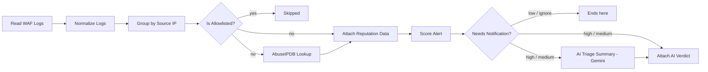

# WAF Auto Alert Triage System

**Automated web application firewall alert triage with n8n, AbuseIPDB, and Google Gemini.**

Security teams don't have an alert shortage, they have a time shortage. This workflow does the first-pass sorting a junior SOC analyst would do on WAF attack logs: it collapses noisy log lines into meaningful alerts, checks each source IP's reputation, scores the risk with transparent rules, and asks an LLM to explain only the alerts that matter.

> **Prototype.** It runs on an exported log file with a manual trigger. It is not a live monitoring or blocking system. See [Limitations](#limitations).

---

## What it does

| Step | Result |
|---|---|
| Reads raw WAF attack logs | 36 log lines |
| Normalizes and groups by source IP | **11 grouped alerts** |
| Enriches each IP with AbuseIPDB | reputation, country, ISP |
| Scores each alert with explainable rules | ignore / low / medium / high |
| Sends only high and medium alerts to Gemini | **5 alerts** get an AI verdict and summary |

The demo dataset in this repo reproduces exactly that behavior.

## Architecture



### Nodes

| Node | Type | Purpose |
|---|---|---|
| Start Triage (Manual) | Manual Trigger | Starts a run |
| Read WAF Logs | Google Sheets | Reads one item per log line |
| Normalize Logs | Code | Cleans rows, standardizes fields and timestamps, identifies the client IP |
| Group by Source IP | Code | One alert per source IP per burst (new group after 10 quiet minutes); counts events and attack types; detects several IPs from the same /24 |
| Is Allowlisted? | IF | Lets known scanners and monitoring tools bypass triage |
| AbuseIPDB Lookup | HTTP Request | Abuse score, report count, country, ISP |
| Attach Reputation Data | Merge (by position) | Reattaches the lookup result to its alert |
| Score Alert | Code | 0 to 100 score, level, and a `reasons` list |
| Needs Notification? | IF | Only high and medium alerts continue |
| AI Triage Summary | Basic LLM Chain + Gemini | Returns verdict, confidence, summary, recommended action |
| Verdict Parser | Structured Output Parser | Forces the AI answer into fixed JSON fields |
| Attach AI Verdict | Merge (by position) | Combines the alert and the AI answer |

## Design decisions

- **Rules score, AI explains.** The score comes from deterministic rules you can audit ([docs/scoring-rules.md](docs/scoring-rules.md)). The AI never sets severity, so a hallucination cannot change an alert's priority.
- **Privacy by design.** The payload sent to the model contains no hostnames, policy names, or internal IPs.
- **Group before analyzing.** Triage per alert, not per log line, to cut noise and API calls.
- **Range correlation.** Several IPs from one /24 behaving alike is a stronger signal than any single event, and is scored as such.
- **Human in the loop.** Nothing is blocked or changed automatically.

## Demo results

Run on [`data/sample_waf_attack_log.csv`](data/sample_waf_attack_log.csv) (synthetic data, reserved documentation IP ranges only). Scores below are from the rules alone, since reserved IPs have no reputation history.

| Source IP | Events | Attack types | Score | Level |
|---|---|---|---|---|
| 198.51.100.103 | 10 | Information Disclosure, HTTP Parsing Error, Illegal HTTP Version | 70 | **high** |
| 198.51.100.70 | 8 | HTTP Parsing Error, Illegal HTTP Version | 55 | medium |
| 198.51.100.71 | 1 | Generic Attacks (Extended) | 55 | medium |
| 198.51.100.74 | 1 | Information Disclosure | 45 | medium |
| 198.51.100.125 | 1 | Information Disclosure | 45 | medium |
| 198.51.100.98 | 1 | GEO IP policy hit | 30 | low |
| 198.51.100.110 | 1 | GEO IP policy hit | 30 | low |
| 203.0.113.248 | 5 | Missing POST Content Type | 20 | ignore |
| 192.0.2.133 | 1 | HTTP Duplicated Parameter Name | 15 | ignore |
| 203.0.113.51 | 3 | Header Value Length Violation | 15 | ignore |
| 203.0.113.248 | 4 | Missing POST Content Type | 10 | ignore |

Seven different IPs in `198.51.100.0/24` hit the WAF, which looks like one scanner using many addresses. The scoring adds points for that pattern. Note the two `203.0.113.248` rows: same IP, two bursts on different days, so two alerts.

Example of the structured AI output (format illustration):

```json
{
  "verdict": "needs_review",
  "confidence": 0.7,
  "summary": "A single generic attack signature fired from an address inside a range that also produced several other alerts. The data does not show whether the request succeeded.",
  "recommended_action": "Review the raw request for this event and check the other IPs in the same /24 for similar activity."
}
```

## Getting started

### Prerequisites

- [n8n](https://n8n.io) (Cloud or self-hosted)
- A Google account for Google Sheets (or use the CSV file alternative below)
- A free [AbuseIPDB](https://www.abuseipdb.com) API key
- A [Google Gemini](https://aistudio.google.com) API key

### Setup

1. **Import the workflow.** In n8n: *Workflows → Import from file* and choose `workflow/waf-auto-alert-triage.json`.
2. **Load the demo data.** Import `data/sample_waf_attack_log.csv` into a new Google Sheet. In the **Read WAF Logs** node, select your sheet and tab.
3. **Create credentials in n8n.**
   - *Google Sheets OAuth2*: see the [n8n Google credentials guide](https://docs.n8n.io/integrations/builtin/credentials/google/).
   - *AbuseIPDB* (Header Auth): **Name** must be exactly `Key`, **Value** is your API key. The label you gave the key on the AbuseIPDB site is not the header name.
   - *Google Gemini (PaLM) API*: your Gemini key.
4. **Run it.** Click *Execute workflow*. You should see 36 items, then 36 normalized, then 11 grouped alerts, then 5 alerts reaching the AI node.

### No Google account? Use the CSV file instead

Replace **Read WAF Logs** with *Read/Write Files from Disk* followed by *Extract From File* (operation: CSV, header row on). Everything else stays the same.

### Using your own logs

The workflow expects these CSV columns: `#, Action, Policy, Source, Destination, URL, HTTP Host, Main Type, Sub Type, Threat Level, Date/Time`. In the original FortiWeb export, **Source and Destination were swapped** relative to the GUI, so the Normalize node picks whichever IP is public as the client. The demo dataset keeps that quirk on purpose. If your export is not swapped, the same logic still works, because the public IP is used either way.

Edit `ALLOWLIST` in the Group node to add your own scanners and monitoring IPs.

### Code and prompts

The three Code nodes and the AI prompts live as plain files so they can be reviewed without opening n8n:

- [`code/01-normalize-logs.js`](code/01-normalize-logs.js)
- [`code/02-group-by-source-ip.js`](code/02-group-by-source-ip.js)
- [`code/03-score-alert.js`](code/03-score-alert.js)
- [`prompts/system-prompt.txt`](prompts/system-prompt.txt), [`prompts/user-prompt.txt`](prompts/user-prompt.txt), [`prompts/verdict-schema-example.json`](prompts/verdict-schema-example.json)

## Troubleshooting

| Symptom | Likely cause |
|---|---|
| AbuseIPDB returns 401 | Credential **Name** is not `Key`, or the key has a stray space |
| Score Alert outputs 1 item | Code node mode must be *Run Once for Each Item* |
| AI node says prompt is required | *Source for Prompt* must be **Define below**, not Chat Trigger |
| Parser error "Unexpected non-whitespace character" | The JSON example box contains more than one object; clear it and paste the schema once |
| Merge output looks mismatched | Both Merge inputs must have the same item count and order |

## Limitations

- Prototype on a static export with a manual trigger; not live monitoring.
- The export has no HTTP response code, so the system cannot tell whether an attack succeeded, and the AI is instructed never to claim it did.
- Every sample row has Action = Alert, so blocked versus allowed is not part of the scoring yet.
- Scoring weights are hand-tuned on a small sample.
- Reserved documentation IPs (used in the demo data) have no reputation history, so the demo scores come from rules only.

## Roadmap

- Live log intake via syslog and a collector workflow
- History of repeat offenders across days
- Response-code and URL-based scoring
- Notifications (Slack, Telegram, or email)
- Approval-based blocking with a human confirmation step

## Repository structure

```
waf-auto-alert-triage/
├── README.md
├── LICENSE
├── workflow/            n8n workflow export (add your sanitized JSON here)
├── data/                synthetic demo dataset
├── code/                Code node scripts
├── prompts/             AI system prompt, user prompt, output schema
└── docs/                scoring rules, sanitization checklist, screenshots
```

## Disclaimer

All data in this repository is synthetic and uses reserved documentation IP ranges (RFC 5737). FortiWeb and Fortinet are trademarks of Fortinet, Inc.; this project is independent and not affiliated with or endorsed by Fortinet.

## License

MIT, see [LICENSE](LICENSE).

## Author

Built by Arefin. [LinkedIn](https://www.linkedin.com/in/your-profile) (replace with your link)
